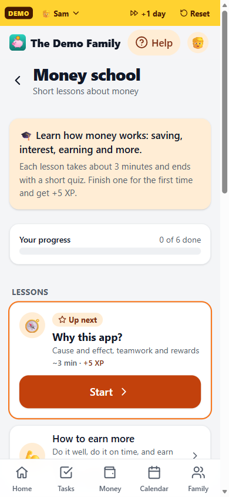

# 🌱 Sow & Grow

**A family app where children learn, day by day, that what they sow, they reap: with their money, their time and their gifts.**

> *"Let's not be weary in doing good, for we will reap in due season if we don't give up."*
> — Galatians 6:9 (WEB)

  
  
  
  

**[▶ Try the demo](https://pocketmoney.nl-dot.com/?demo=1)**: no account needed. It runs entirely on your phone or computer, with a made-up family, and nothing is saved online.

---

## Why we made it

Sow & Grow started with a dad of a blended family, with two homes in two countries and three teenagers, who wanted his children to grow up knowing four things:

- **What you do has a result.** Do your part and you see it grow. Leave it, and it costs you a little. Not as punishment, but as the way life works.
- **Money is something we look after.** Earning, saving, giving and waiting for something good are learned with small amounts, long before the big ones.
- **Faith belongs in everyday life.** Including how we handle money, time and the gifts God gives us.
- **Family is a team.** Parents, bonus parents, grandparents, aunts and uncles all play a part, and children can challenge their parents too.

So Sow & Grow is not a chore chart and not a punishment app. It's a small, daily practice of responsibility, generosity and grace for the whole family.

## ✝️ Faith at the heart

Christians call it **stewardship**: everything we have is God's, and we get to look after it.

> *"The earth is the LORD's, with its fullness; the world, and those who dwell in it."* — Psalm 24:1
>
> *"He who is faithful in a very little is faithful also in much."* — Luke 16:10

Children practise that faithfulness with a little: a bit of pocket money, an hour of screen time, a job done well. Sow & Grow brings faith into those everyday moments.

### 🕊️ A verse of the day
On everyone's home screen, the **same verse for the whole family each day**, so it can come up at the dinner table. One tap on **Read in the Bible App** opens it in the YouVersion Bible App, to read the whole chapter.

### 📖 Six faith reflections
Short, warm reflections for children, each with Bible verses and a question to think or talk about, most with everyday examples in your family's own money.

| | Reflection | What children explore |
|---|---|---|
| 🤲 | **Faith and money** | It all belongs to God. Being faithful with a little. Working with all your heart. Money is good; loving it isn't. Treasure in heaven. |
| 🎁 | **Giving, blessing and provision** | Every good gift comes from God. He provides what we *need*. Giving with a cheerful heart. Spend, save and give jars. |
| 🌾 | **Tithing: giving the first tenth** | What a tithe is, worked out with their own pocket money. Abraham and Jacob. Malachi 3:10 as an invitation to trust, not a deal to get rich. Jesus on justice and mercy. How they could start. |
| 🏡 | **Family: parents and children** | Children are a gift. Love and honour go *both ways* (Ephesians 6:1-4). God sets the lonely in families, which is good news for blended families. A fresh start every morning. |
| ⛪ | **One faith, many churches** | What all Christians share, and why there are Catholic, Orthodox, Protestant, Methodist, Reformed, Baptist, Pentecostal and African independent churches. What "evangelical" means. |
| 🌍 | **Christians and other faiths** | What Jews, Muslims, Hindus and Buddhists believe, and what spiritualism and honouring ancestors mean, described kindly and accurately. What Christians believe differently, and how we love our neighbours. |

Verses also run through the everyday money lessons, such as **saving** little by little (Proverbs 13:11) and **planning** before buying (Luke 14:28). The Tasks page carries **working** with all your heart (Colossians 3:23).

### 🤝 How we handle faith in the app
We thought hard about this, especially for families where not everyone believes the same.

- **Faith is invited, never tested.** There are no quizzes, scores or points on faith.
- **Verses are never used next to fines or consequences.** The app's consequences are family rules, not God's punishment. Mistakes meet grace and a fresh start.
- **Love goes both ways.** Verses for children always come with the verses for parents.
- **Stewardship and gratitude, not "give to get rich".**
- **Other churches and faiths are described with respect.**
- **It's optional and personal.** A parent switches faith on for the family, and **each person can hide the verses for themselves**, which matters when a child has a parent in another home who sees things differently.
- **The Bible text** in the app is the *World English Bible* (public domain). The links open the verse in the Bible App in the NIV.

## 💰 ⏱️ ✨ Money, time and effort: three things to look after

> *"As each has received a gift, employ it in serving one another, as good managers of the grace of God."* — 1 Peter 4:10

- **Money.** Children have two pots: a **Wallet** 👛 and **Savings** 🐷.
  - Pocket money arrives automatically, every week or every month.
  - They earn more with jobs done well, and ask before spending.
  - They save towards a goal and watch it grow with a savings bonus.
  - Optionally, they see their real bank balance next to the app, and amounts in a second currency (e.g. euro pocket money for children who shop in rand).
- **Time.** Screen time (Wi-Fi, games, fun) can be earned and spent like money, with a parent's OK.
- **Effort.** Points level up a character, which shows all the effort a child has put in.

Parents decide which of these the family uses.

## 🎓 Money school

Six short basic lessons (about 3 minutes each) that use your own family's numbers. Each one ends with a little quiz.

1. **Why this app?** Cause and effect, responsibility and teamwork.
2. **How to earn more.** Do it well, on time, and ask for extra jobs.
3. **Why save?** Needs and wants (a sorting game), surprises, and why waiting is a superpower.
4. **How to save.** Pay yourself first, the spend/save/give jars, and the 24-hour rule.
5. **How interest works.** A calculator: no interest vs the family's savings bonus vs a real bank. Plus why borrowing costs money.
6. **Saving for a goal.** How many weeks until you can buy it?

Plus a themed series that opens on a date. **December: Borrowing and insurance** (opens 1 December) has six more lessons: how loans work, paying a loan back (with a loan calculator), what insurance is, insurance for people, home and car insurance, and phones, valuables and boats. Before it opens, kids see a locked preview; parents can look ahead.

Parents can see which lessons each child has finished.

## 👨‍👩‍👧‍👦 How it works, day to day

**For children**
- See today's jobs, do them, and add a photo. When a parent says OK, the reward lands in their wallet.
- A missed job costs a little, and a parent can excuse it when there's a good reason.
- Save up, set goals, ask to spend, take on challenges, and challenge their parents too.
- Pick a character and colours; everyone has their own look.

**For parents**
- Jobs that repeat by themselves, with one tap to approve or send back.
- **Spotted 📸:** notice something good (or not so good), pick the child, choose reward or consequence and say what happened. The amount is a fixed family rule, so it's fair and quick.
- Pocket money, family rules, and an activity log of who changed what, so parents in different homes stay in step.
- **Start small:** switch on one part at a time as your family gets used to it.

**For bonus parents, grandparents and other family**
- Bonus parents can do everything parents can.
- Grandparents, aunts, uncles and godparents can send gifts and set fun challenges. They can see the children, and the children's money if your family rules allow it.

**🛍️ What we need** (for the grown-ups)
- Note what each child needs, such as school shoes, a school bag, stationery or a lunch box, for an occasion: new term, birthday, Christmas, or one you make up.
- Any adult, including grandparents, aunts and uncles, can tap **"I'll get it"** so nobody buys the same thing twice, then **"Bought"**. Everyone sees who bought it and when.
- Children can't see this list, so surprises stay surprises.

**For the whole family**
- A shared calendar with reminders and birthdays.
- An emergency card (allergies, medication, blood type, contacts).
- A list of the devices at home.
- A helper, **Ask Pocket**, that answers children's questions about the app, money and faith. Parents can read every question.

## 🏠 Built for real families

- **Blended families are normal here.** Parents, *bonus parents*, guardians, grandparents and other family like aunts, uncles and godparents, with your own labels ("Bonus dad", "Oma", "Godmother"). Children from 0 to 21.
- **Joining is easy:** scan a QR code. No email addresses needed, which is ideal for children.
- **Two homes, two countries:** an optional second currency with today's exchange rate.
- **On every phone:** open it in the browser and choose *Add to Home Screen*. It works like an app.

## 🔒 Privacy

- Each copy of the app belongs to **one family**. Nobody else can join without a QR code from a parent.
- Children see only their own money. Siblings can't see each other's money, and photos are private to the family.
- No ads and no tracking. Your family's data lives in your own database.
- The **Ask Pocket** helper (optional) sends Anthropic (Claude) only the question as typed, plus the asker's role, relationship label and age, the family's currency and which parts of the app are on. It never sends names, the family name or balances. Questions are kept in your own database, and parents can read them.

## Use Sow & Grow in your family

Sow & Grow is free and open source. Each family runs its own private copy. Setting one up takes about 20 minutes and costs nothing: see **[docs/SETUP.md](docs/SETUP.md)**. Have ideas or found a problem? [Open an issue](https://github.com/trust-fullstop/pocket-money/issues).

📬 **Want more information, or help getting started?** Send an email to **[trust@racecar.foundation](mailto:trust@racecar.foundation)** and someone will get back to you.

**Not yet:** push notifications, automatic Wi-Fi device scanning, and an automatic bank connection.

## For developers

See **[docs/DEVELOPMENT.md](docs/DEVELOPMENT.md)** (how it's built and how to run it), **[docs/SPEC.md](docs/SPEC.md)** (the full product spec) and **[.squad/decisions/](.squad/decisions/)** (the decisions behind the design).

## Thanks

- Bible text: the **World English Bible** (public domain), via [bible-api.com](https://bible-api.com). Verse links go to the **YouVersion Bible App** ([bible.com](https://www.bible.com)).
- Built with Supabase, Cloudflare Pages and React. The Ask helper uses Claude by Anthropic.

## License

[MIT](LICENSE): free to use, change and share, also for your own family or church. The Bible text is public domain.

*Sow & Grow was called "Pocket Money" in its first days, which is why the web address and repository still use that name.*
