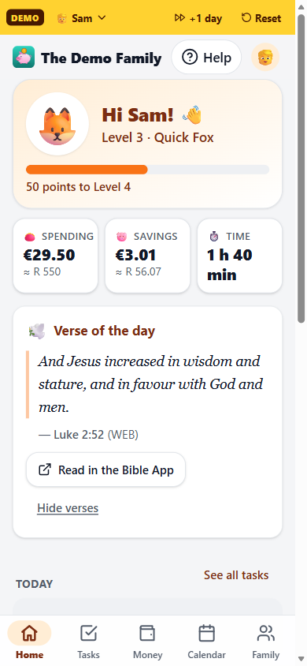
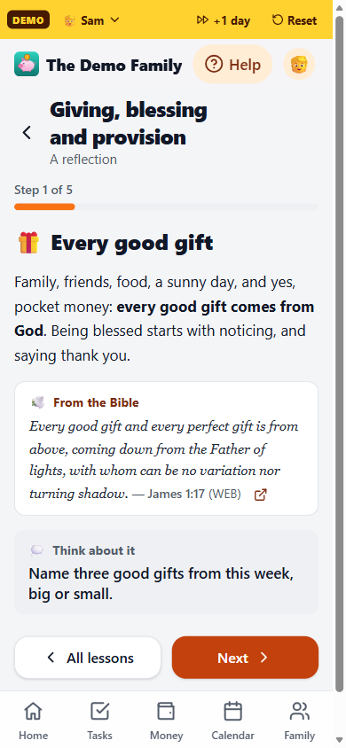
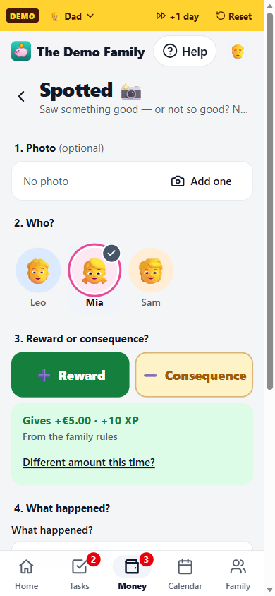
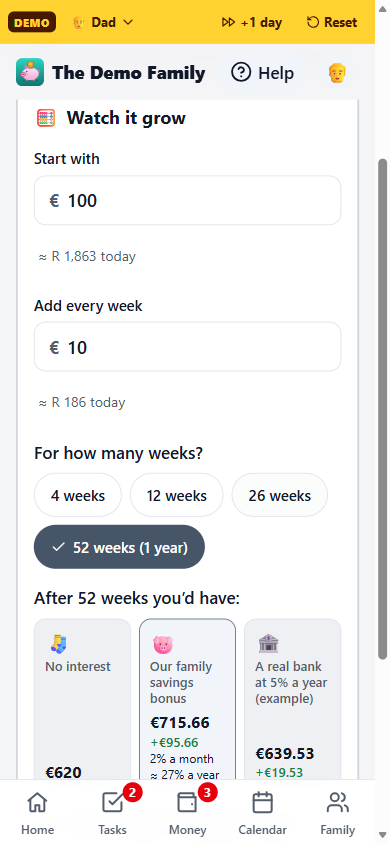

# 🌱 Sow & Grow

**A family app where children learn, day by day, that what they sow, they reap: with their money, their time and their gifts.**

> *"Let's not be weary in doing good, for we will reap in due season if we don't give up."*
> — Galatians 6:9 (WEB)

  
  
  
  

**[▶ Try the demo](https://pocketmoney.nl-dot.com/?demo=1)**: no account needed. It runs entirely on your phone or computer, with a made-up family, and nothing is saved online.

**In a hurry?** See [everything in the app at a glance](#-whats-in-the-app).

---

## Why we made it

Sow & Grow started with a dad of a blended family, with two homes in two countries and three teenagers, who wanted his children to grow up knowing four things:

- **What you do has a result.** Do your part and you see it grow. Leave it, and it costs you a little. Not as punishment, but as the way life works.
- **Money is something we look after.** Earning, saving, giving and waiting for something good are learned with small amounts, long before the big ones.
- **Faith belongs in everyday life.** Including how we handle money, time and the gifts God gives us.
- **Family is a team.** Parents, bonus parents, grandparents, aunts and uncles all play a part, and children can challenge their parents too.

So Sow & Grow is not a chore chart and not a punishment app. It's a small, daily practice of responsibility, generosity and grace for the whole family.

## ✝️ Faith at the heart

Christians call it **stewardship**: everything we have is God's, and we get to look after it.

> *"The earth is the LORD's, with its fullness; the world, and those who dwell in it."* — Psalm 24:1
>
> *"He who is faithful in a very little is faithful also in much."* — Luke 16:10

Children practise that faithfulness with a little: a bit of pocket money, an hour of screen time, a job done well. Sow & Grow brings faith into those everyday moments.

### 🕊️ A verse of the day
On everyone's home screen, the **same verse for the whole family each day**, so it can come up at the dinner table. One tap on **Read in the Bible App** opens it in the YouVersion Bible App, to read the whole chapter.

### 📖 Six faith reflections
Short, warm reflections for children, each with Bible verses and a question to think or talk about, most with everyday examples in your family's own money.

| | Reflection | What children explore |
|---|---|---|
| 🤲 | **Faith and money** | It all belongs to God. Being faithful with a little. Working with all your heart. Money is good; loving it isn't. Treasure in heaven. |
| 🎁 | **Giving, blessing and provision** | Every good gift comes from God. He provides what we *need*. Giving with a cheerful heart. Spend, save and give jars. |
| 🌾 | **Tithing: giving the first tenth** | What a tithe is, worked out with their own pocket money. Abraham and Jacob. Malachi 3:10 as an invitation to trust, not a deal to get rich. Jesus on justice and mercy. How they could start. |
| 🏡 | **Family: parents and children** | Children are a gift. Love and honour go *both ways* (Ephesians 6:1-4). God sets the lonely in families, which is good news for blended families. A fresh start every morning. |
| ⛪ | **One faith, many churches** | What all Christians share, and why there are Catholic, Orthodox, Protestant, Methodist, Reformed, Baptist, Pentecostal and African independent churches. What "evangelical" means. |
| 🌍 | **Christians and other faiths** | What Jews, Muslims, Hindus and Buddhists believe, and what spiritualism and honouring ancestors mean, described kindly and accurately. What Christians believe differently, and how we love our neighbours. |

Verses also run through the everyday money lessons, such as **saving** little by little (Proverbs 13:11) and **planning** before buying (Luke 14:28). The Tasks page carries **working** with all your heart (Colossians 3:23).

### 🤝 How we handle faith in the app
We thought hard about this, especially for families where not everyone believes the same.

- **Faith is invited, never tested.** Beliefs are never scored. Lessons may ask about the facts of a Bible story, but never about what you believe. The faith reflections have no quiz and nothing to score.
- **Verses are never used next to fines or consequences.** The app's consequences are family rules, not God's punishment. Mistakes meet grace and a fresh start.
- **Love goes both ways.** Verses for children always come with the verses for parents.
- **Stewardship and gratitude, not "give to get rich".**
- **Other churches and faiths are described with respect.**
- **It's optional and personal.** A parent switches faith on for the family, and **each person can hide the verses for themselves**, which matters when a child has a parent in another home who sees things differently.
- **The Bible text** in the app is the *World English Bible* (public domain). The links open the verse in the Bible App in the NIV.
- **A Bible time surprise, if you like** (Family rules, off by default). You can choose a small amount that a child gets once a day when they tap **Read in the Bible App** or **Open the Bible App** in Sow & Grow. The children aren't told beforehand and never see the setting. The first time they tap a link on a day, they get a "🥚 You found a surprise" message and a "📖 Bible time" line in their Wallet history. It's a family gift, not payment for believing. The app only sees the tap on its own link, never what (or whether) they read. Parents can see on how many days each child opened it.

## 💰 ⏱️ ✨ Money, time and effort: three things to look after

> *"As each has received a gift, employ it in serving one another, as good managers of the grace of God."* — 1 Peter 4:10

- **Money.** Children have two pots, a **Wallet** 👛 and **Savings** 🐷, on their own **My money** page.
  - Pocket money arrives automatically, every week or every month, on a day you choose.
  - They earn more with jobs done well, and ask before spending.
  - They save towards a goal and watch it grow with a little interest every week.
  - They can **borrow** from a parent for something that matters, and choose how to pay it back from their pocket money.
  - A **How you're doing** card shows this week, this month and this year: what they earned, lost, saved, spent, borrowed and paid back.
  - Optionally, they see their real bank balance next to the app, and amounts in a second currency (handy when pocket money is counted in euros but the children shop in another currency).
- **Time.** Screen time (Wi-Fi, games, fun) can be earned and spent like money, with a parent's OK.
- **Effort.** Points level up a character, which shows all the effort a child has put in.

Parents decide which of these the family uses.

## 🎓 Money school

Six short basic lessons (about 3 minutes each) that use your own family's numbers. Each one ends with a little quiz. If your family uses points, children get a few the first time they finish a lesson.

1. **Why this app?** Cause and effect, responsibility and teamwork.
2. **How to earn more.** Do it well, on time, and ask for extra jobs.
3. **Why save?** Needs and wants (a sorting game), surprises, and why waiting is a superpower.
4. **How to save.** Pay yourself first, the spend/save/give jars, and the 24-hour rule.
5. **How interest works.** A calculator: no interest vs the family's savings bonus vs a real bank. Plus why borrowing costs money.
6. **Saving for a goal.** How many weeks until you can buy it?

Plus a themed series that opens on a date. **December: Borrowing and insurance** (opens 1 December, then stays open) has six more lessons: how loans work, paying a loan back (with a loan calculator), what insurance is, insurance for people, home and car insurance, and phones, valuables and boats. Before it opens, kids see a locked preview; parents can look ahead.

With faith switched on, the six faith reflections are in Money school too, with no quiz and nothing to score.

Parents can see which lessons each child has finished.

**Money school reward** (Family rules): set an amount per lesson and each child gets it once for every lesson they finish for the first time. It goes into their Wallet and shows as its own line in the Pay-out ("Money school (3 lessons × €2)"). Lessons finished before there was a reward can be rewarded with one tap, so they count in this pay-out.

## 👨‍👩‍👧‍👦 How it works, day to day

You don't need a chore chart. Some families set regular jobs. Others mostly use the app as life happens: a parent spots something good, a child shows what they did, and pocket money comes in by itself. Both work.

**For children**
- See today's jobs, do them, and add a photo. When a parent says OK, the reward lands in their Wallet.
- A missed job costs a little, and a parent can excuse it when there's a good reason.
- **Look what I did ⭐:** did something good without being asked? Tap **I did something good**, add a photo and a few words. A parent can give the family reward, say thanks, or say "Let's talk about it".
- Save up, set goals, ask to spend, take on challenges, and challenge their parents too.
- Pick colours and an avatar (and a character, with points on); everyone has their own look.

**For parents**
- Jobs that repeat by themselves, with one tap to approve or send back.
- **Spotted 📸:** notice something good (or not so good), pick the child, choose **Reward** or **Consequence** and say what happened. The amount is a fixed family rule (set once in Family rules), so it's fair and quick. You can pick a different amount if you really need to.
- **Proud moments ⭐:** when a child shows what they did, reward it, say thanks, or say "Let's talk about it".
- **Loans 🤝** (off until you switch them on):
  - A child asks to borrow, says what it's for and picks a plan: a fixed part of each pocket money, or all of the next one.
  - You say yes or no, or offer a small fee, like interest at a bank. Already lent them something? Record it.
  - Repayments come off their pocket money, but never more than is in their Wallet.
  - They can pay back early, and you can forgive what's left. That's grace.
- **Pay-out 💸** (Family → Pay-out): for the parent who acts as "the bank" and pays each child's Wallet into their real account.
  - For each child, everything since the last pay-out, line by line: pocket money, rewards, consequences, loan repayments, Money school, Bible time and spending.
  - How much more or less than the normal pocket money that is, and why.
  - With a second currency, both amounts are shown large, with today's European Central Bank rate.
  - Tap **Paid ✅** once you've paid (you can undo it). Savings stay in the app.
  - Loans show here too: what's been paid back, what's still to go, and what comes off the next pocket money.
- Pocket money, family rules, and an activity log of who changed what, so parents in different homes stay in step.
- **Start small:** switch on one part at a time as your family gets used to it.

**For bonus parents, grandparents and other family**
- Bonus parents can do everything parents can.
- Grandparents, aunts, uncles and godparents can send gifts and set fun challenges. They can see the children, and the children's money if your family rules allow it. They can't change the rules or give consequences, and loans stay between the child and the parents.

**🛍️ What we need** (for the grown-ups)
- Note what each child needs, such as school shoes, a school bag, stationery or a lunch box, for an occasion: new term, birthday, Christmas, or one you make up.
- Any adult, including grandparents, aunts and uncles, can tap **"I'll get it"** so nobody buys the same thing twice, then **"Bought"**. All the grown-ups see who bought it and when, and bought things stay on the list for a year.
- Children can't see this list, so surprises stay surprises.

**For the whole family**
- A shared calendar with reminders and birthdays.
- An emergency card (allergies, medication, blood type, contacts).
- A list of the devices at home.
- A **Help** button at the top of the app: how it works, what each part does (with examples), and answers to common questions.
- A helper, **Ask Pocket**, that answers children's questions about the app, money and faith. Parents can read every question.

## 🧺 What's in the app

Everything at a glance. Parents choose what the family uses in **Family → Features**: start with **Start small** and switch more on when you're ready.

**Everyday**
- ✅ **Tasks** (always there, use them if you like): jobs with a time, that can repeat by themselves, with a photo to show they're done. Approve or send back. A missed job costs a little and can be excused.
- 🏆 **Challenges:** one-off challenges with a reward. Children can challenge their parents, or you do one together.
- 📸 **Spotted:** a quick **Reward** or **Consequence** at the amounts set in Family rules. Grandparents and other family use it to send gifts.
- ⭐ **Look what I did:** children show something good they did on their own, and a parent responds (part of Spotted).
- 🗓️ **Calendar:** family events, reminders and birthdays, for everyone or just some of you.
- 🛍️ **What we need:** what each child needs, for which occasion, and who's getting it (grown-ups only).
- 🎨 **Your own look:** everyone picks an avatar, a colour, light or dark, and (with points on) a character (Me → My look).

**Money**
- 👛 **Wallet** (always on): each child's own **My money** page, with how they're doing this week, month and year.
- 📅 **Pocket money:** paid automatically, every week or every month, on a day you choose.
- 🙋 **Requests:** children ask before they spend money or use time.
- 🐷 **Savings:** a second pot, with **interest** every week, **saver rules** (bonus points for saving) and **savings goals** with the weeks to go.
- 🏁 **Targets:** a weekly or monthly aim, with a prize.
- 🤝 **Loans:** children borrow from a parent, with their own plan to pay it back.
- 🏦 **Real bank balance:** type in what a child's real bank account says, to see it next to the app.
- 🪙 **Second currency:** also show amounts in another currency at today's rate (Family rules → *Also show money in*).

**Time and effort**
- ⏱️ **Time:** Wi-Fi, game or fun minutes, earned and spent like money.
- 🌟 **Points and levels:** points for tasks, and a character that levels up.

**Learning**
- 🎓 **Money school:** six basic lessons, plus a themed series (December: Borrowing and insurance). Optional money reward per finished lesson.
- ❓ **Help:** always there, at the top of the app.
- 💬 **Ask Pocket:** a helper for questions (off until a parent switches it on; it needs an AI key, see [setup](docs/SETUP.md)).

**Faith** (off until a parent switches it on)
- 🕊️ **Verse of the day**, 📖 **six faith reflections** and links to the Bible App. Each person can hide the verses.
- 🥚 **Bible time surprise** (optional, off by default): a small daily gift for a child who opens the Bible App from Sow & Grow. See [how we handle faith](#-how-we-handle-faith-in-the-app).

**For parents**
- 💸 **Pay-out:** what to pay each child since the last pay-out, line by line, in one or two currencies, with loans, Money school and Bible time on their own lines. Tap **Paid ✅** (and undo if needed).
- ⚙️ **Family rules:** currency, second currency, time zone, Spotted amounts, interest, Money school reward, Bible time surprise, who sees what, and an **activity log** of who changed what.
- 🌱 **About this app** (near the bottom of Family rules): the version on this phone and when it came out.

**Safety and privacy**
- 📷 **Join with a QR code:** no email needed. Add a username and password (or Google, if your copy has it) so you never lose access.
- 🔒 **App lock:** a PIN or pattern for a phone you share (Me → Sign-in & devices).
- 🆘 **Emergency card:** allergies, medication, blood type, doctor and who to call, for the whole family or just the grown-ups.
- 📱 **Devices:** the phones, tablets and consoles at home.
- 🔄 **Always up to date:** the app updates itself when it's opened.

## 🏠 Built for real families

- **Blended families are normal here.** Parents, *bonus parents*, guardians, grandparents and other family like aunts, uncles and godparents, with your own labels ("Bonus dad", "Oma", "Godmother"). Children from 0 to 21.
- **Joining is easy:** scan a QR code. No email addresses needed, which is ideal for children.
- **Two homes, two countries:** an optional second currency with today's exchange rate.
- **On every phone:** open it in the browser and choose *Add to Home Screen*. It works like an app.
- **Always the newest version:** the app updates itself when you open it, and waits if you're in the middle of something. Parents can see the version and when it came out in **Family → Family rules → About this app**.

## 🔒 Privacy

- Each copy of the app belongs to **one family**. Nobody else can join without a QR code from a parent.
- Children see only their own money. Siblings can't see each other's money, and photos are private to the family.
- **Loans** stay between the child and the parents: grandparents and other family only see a "pocket money adjustment". **What we need** is for the grown-ups only.
- No ads and no third-party tracking. Your family's data lives in your own database.
- **Bible time:** with faith switched on, the app records the days a child taps a Bible App link in Sow & Grow (how many taps that day, the first and last time, and which link came first), and parents can see how many days. It can't see what they read, or the Bible App opened any other way. A child who hides the verses isn't counted.
- **Exchange rates** (only with a second currency) come from free public services: European Central Bank rates, with a back-up service if that one can't be reached. The app only asks for the two currencies; nothing about your family is sent.
- The **Ask Pocket** helper (optional) sends Anthropic (Claude) only the question as typed, plus the asker's role, relationship label and age, the family's currency and which parts of the app are on. It never sends names, the family name or balances. Questions are kept in your own database, and parents can read them.

## Use Sow & Grow in your family

Sow & Grow is free and open source. Each family runs its own private copy. Setting one up takes about 20 minutes and costs nothing: see **[docs/SETUP.md](docs/SETUP.md)**, which also explains how to keep your copy up to date. Have ideas or found a problem? [Open an issue](https://github.com/trust-fullstop/pocket-money/issues).

📬 **Want more information, or help getting started?** Send an email to **[trust@racecar.foundation](mailto:trust@racecar.foundation)** and someone will get back to you.

**Not yet:** push notifications, automatic Wi-Fi device scanning, and an automatic bank connection.

## For developers

See **[docs/DEVELOPMENT.md](docs/DEVELOPMENT.md)** (how it's built, how to run it, and what each database migration adds), **[docs/SPEC.md](docs/SPEC.md)** (the original product spec) and **[.squad/decisions/](.squad/decisions/)** (the decisions behind the design).

## Thanks

- Bible text: the **World English Bible** (public domain), via [bible-api.com](https://bible-api.com). Verse links go to the **YouVersion Bible App** ([bible.com](https://www.bible.com)).
- Built with Supabase, Cloudflare Pages and React. The Ask helper uses Claude by Anthropic.

## License

[MIT](LICENSE): free to use, change and share, also for your own family or church. The Bible text is public domain.

*Sow & Grow was called "Pocket Money" in its first days, which is why the web address and repository still use that name.*
